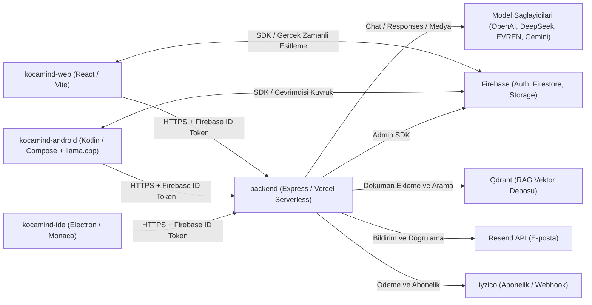

# KocaMind Mimari ve Veri Akışı

Bu belge KocaMind sisteminin bileşenlerini, bir sohbet isteğinin sunucu içindeki yolunu, Firestore koleksiyonlarını, güvenlik katmanlarını, zamanlanmış işleri (cron) ve kodda görülen bilinen boşlukları özetler.

## 1. Bileşen Diyagramı



## 2. Bir Sohbet İsteğinin Yolu (`POST /chat`)

Aşağıdaki sıra diyagramı, istemciden gelen bir `/chat` isteğinin backend içinde izlediği adımları ve ilgili kaynak dosyaları gösterir:

```mermaid
sequenceDiagram
  participant Client as Istemci
  participant Auth as requireAuth (server.js)
  participant Quota as enforceDailyQuota (quota.js)
  participant Guard as scanMessage (jailbreakGuard.js)
  participant Prep as Hafiza ve On Arama (packStore.js, grounding.js)
  participant Prompt as Sistem Prompt (prompt.js, securityCore.js, tone.js)
  participant Loop as Model ve Arac Dongusu (chat.js, chatToolLoop.js / responsesToolLoop.js)
  participant Metrics as metrics.track (metrics.js)

  Client->>Auth: POST /chat (Bearer ID Token)
  Auth->>Auth: verifyIdToken + deletionPending kontrolu
  Auth->>Quota: Kullanici kotasi kontrol ve dusum (Firestore transaction)
  alt Kota asildi
    Quota-->>Client: 429 daily_limit
  else Kota uygun
    Quota->>Guard: Mesaj uzunlugu + jailbreak on taramasi
    alt Jailbreak engeli
      Guard-->>Client: 400 jailbreak_blocked
    else Temiz
      Guard->>Prep: Paralel okuma (memory_pack, userStyle, connectors, userSkills, grounding)
      Prep->>Prompt: SECURITY_CORE + skill/customPrompt + toneRules + hafiza + liveDataRules
      Prompt->>Loop: Saglayici secimi (autoRouter / model) + yedek model hazirligi
      Loop->>Client: SSE akisi veya JSON yanit
      Loop->>Metrics: Gecikme, token, durum kodu ve maliyet kaydi
      opt 500/502/503/504 veya headersSent oncesi kopma
        Quota->>Quota: refundDailyQuota (kota iadesi)
      end
    end
  end
```

Adımların dosya karşılıkları:
1. **Kimlik doğrulama ve silme kilidi:** `backend/server.js` (`requireAuth`) ve `backend/routes/account.js` (`blockPendingDeletion`).
2. **Abonelik ve günlük kota:** `backend/routes/chat.js` (`requireDeepResearchPlus`) ve `backend/quota.js` (`enforceDailyQuota('chat')`, `Idempotency-Key` desteği).
3. **Jailbreak ön taraması:** `backend/skills/jailbreakGuard.js` (`scanMessage`).
4. **Hafıza paketi ve bağlam hazırlığı:** `backend/memory/packStore.js` (`packStore.get`), `backend/memory/select.js` (`renderMemoryPrompt`), `backend/llm/grounding.js` (`prefetchGrounding`), `backend/learning/userStyle.js`, `backend/connectors/manager.js`.
5. **Sistem prompt'u:** `backend/skills/securityCore.js` (`SECURITY_CORE`), `backend/skills/prompt.js` (`buildSystemPrompt`), `backend/skills/tone.js` (`toneRules`), `backend/memoryAssist.js` (`withConversationSummary`).
6. **Model seçimi, araç döngüsü ve akış:** `backend/learning/router.js` (`autoRouter.choose`), `backend/routes/chat.js` (`pickFallbackModel`), `backend/llm/responsesToolLoop.js` (OpenAI Responses), `backend/llm/chatToolLoop.js` (OpenAI uyumlu sağlayıcılar).
7. **Ölçümleme:** `backend/metrics.js` (`metrics.track`).
8. **Kota iadesi ve kesilen akış tekrarı (`backend/quota.js`, commit `e8402ee`):** Yanıt `500`, `502`, `503`, `504` ile biterse kota her rotada otomatik iade edilir. Başlıklar gönderilmeden bağlantı kapanırsa iade YALNIZ işi gerçekten iptal eden rotalarda (`res.locals.quotaCancelsOnClose`: chat, ide, agent) yapılır; belge yükleme, görsel, video gibi işi sürdüren rotalarda kopma iade almaz. Sohbet akışı içerik üretmeden sağlayıcı hatasıyla biterse tek seferlik iade yapılır. Akış `200` ile başladıktan sonra yarıda koparsa iade yapılmaz; ancak geçerli `Idempotency-Key` taşıyan ve başlık sonrası kopan deneme (`interrupted: true`) için, `10` dakikalık TTL içinde aynı anahtarla gelen bir sonraki deneme tek seferliğine (`replayUsed: true`) kota düşmeden çalıştırılır. Aynı anahtarla iki başarılı istek iki hak tüketir; bağlantı kopmasında arka plan işini durdurma (`AbortController`) yalnızca `chat` (`backend/routes/chat.js`), `ide` (`backend/routes/ide.js`) ve `agent` (`backend/agent/routes.js`) rotalarında uygulanır.

## 3. Firestore Koleksiyonları

Hesap silme (`backend/routes/account.js`) sırasında `USER_OWNED_COLLECTIONS` listesi ve `purgeSteps` fonksiyonu kullanılır.

| Koleksiyon | Ne Tutar | Belge Kimliği Biçimi | Hesap Silmede Temizleniyor mu |
|---|---|---|---|
| `users` | Kullanıcı profili ve `billing` durumu | `{uid}` | Evet (`users/{uid}`) |
| `users/{uid}/chats` | Bulut sohbet geçmişi | `{chatId}` | Evet (`purgeSteps`) |
| `users/{uid}/memories` | Kullanıcı hafıza kayıtları | `{memoryId}` | Evet (`memoryStore.deleteAllMemories`) |
| `users/{uid}/memory_pack` | Derlenmiş hafıza paketi | `current` | Evet (`purgeSteps`) |
| `users/{uid}/skills` | İnternetten kurulan skill'ler | `{skillName}` | Evet (`purgeSteps`) |
| `users/{uid}/skillInstalls` | Bekleyen skill kurulum onayları | `{installId}` | Evet (`purgeSteps`) |
| `users/{uid}/invoices` | Fatura kayıtları | `{invoiceId}` | **Hayır** (yasal saklama yükümlülüğü) |
| `users/{uid}/settings` | Web özel asistan ayarları (`assistants`) | `{settingId}` | Evet (`backend/routes/account.js` `purgeSteps`, commit `e8402ee`) |
| `admin_profiles` | Yönetici profil analizi | `{uid}` | Evet (`memoryStore.deleteProfile`) |
| `feedback` | Mesaj beğen/beğenme geri bildirimleri | `{uid}_{chatId}_{messageId}` | Evet (`USER_OWNED_COLLECTIONS`) |
| `usage_daily` | Günlük kota sayaçları ve token/maliyet | `{uid}_{YYYY-MM-DD}` | Evet (`USER_OWNED_COLLECTIONS`) |
| `usage_keys` | Idempotency-Key kota kayıtları | `{uid}_{kind}_{key}` | Evet (`USER_OWNED_COLLECTIONS`); ayrıca `expiresAt` için Firestore TTL politikası konsoldan kurulmalı |
| `client_errors` | İstemci hata telemetrisi | Otomatik ID | Evet (`USER_OWNED_COLLECTIONS`) |
| `product_events` | Ürün kullanım olayları | Otomatik ID | Evet (`USER_OWNED_COLLECTIONS`) |
| `bug_reports` | Kullanıcı hata bildirimleri | Otomatik ID | Evet (`purgeSteps`) |
| `video_jobs` | Video üretim iş durumları | `{jobId}` | Evet (`USER_OWNED_COLLECTIONS`) |
| `agent_runs` | Agent çalıştırma kayıtları | `{runId}` | Evet (`USER_OWNED_COLLECTIONS`) |
| `tool_executions` | Agent araç çalıştırma günlükleri | `{execId}` | Evet (`USER_OWNED_COLLECTIONS`) |
| `confirmation_requests` | Agent onay istekleri | `{confirmId}` | Evet (`USER_OWNED_COLLECTIONS`) |
| `welcome_emails` | Hoş geldin e-postası gönderim kaydı | `{uid}` | Evet (`USER_OWNED_COLLECTIONS`) |
| `connector_connections` | Şifreli OAuth bağlayıcı tokenları | `{uid}_{connectorId}` / sorgu | Evet (`USER_OWNED_COLLECTIONS`) |
| `connector_oauth_states` | Geçici OAuth state kayıtları | `{state}` | Hayır |
| `eval_cases` | Beğenilmeyen yanıtlardan oluşan test seti | `{evalCaseId}` | Evet (`USER_OWNED_COLLECTIONS`) |
| `user_style` | Öğrenilen yanıt tarzı tercihi | `{uid}` | Evet (`USER_OWNED_COLLECTIONS`) |
| `account_deletions` | 60 günlük silme bekleme ve ilerleme kaydı | `{uid}` | Evet (silme bitince silinir) |
| `pending_deletions` | Başarısız Qdrant silmeleri için tekrar kuyruğu | `{uid}` | Evet (cron `retryPendingQdrant` ile temizlenir) |
| `model_metrics` | Model bazlı günlük çağrı/hata/gecikme/maliyet | `{day}_{provider}_{model}` | Hayır (anonim sistem metriği) |
| `model_scores` | Kategori ve model bazlı oy sayaçları | `{category}_{model}` | Hayır (toplulaştırılmış sayaç) |
| `improvement_reports` | Gece öğrenme işi günlük raporu | `{YYYY-MM-DD}` | Hayır (sistem raporu) |
| `alert_state` | Aynı gün içinde tekrar uyarı atmamak için durum | `{day}_{provider}_{model}_{reason}` | Hayır (sistem durumu) |
| `billing_sessions` | iyzico ödeme oturumları | `{token}` | Hayır (ödeme/denetim kaydı) |
| `billing_subscriptions` | iyzico abonelik eşlemeleri | `{referenceCode}` | Hayır (ödeme/denetim kaydı) |
| `ide_login_codes` | Tek kullanımlık IDE giriş kodu özetleri | `{codeHash}` | Hayır (kısa ömürlü kod) |
| `health` | Sağlık kontrolü ping belgesi | `ping` | Hayır |

## 4. Güvenlik Katmanları

- **Firebase Auth ve Yetki Kontrolleri (`backend/server.js`, `backend/routes/auth.js`, `backend/billing.js`, `backend/routes/account.js`):**
  - `requireAuth` (`backend/server.js:372`) öncesinde kaydedilen herkese açık uçlar ve her birinin kendi koruması:
    - `GET /`, `GET /health` (`backend/server.js`): yalnızca genel durum (`ok`/`degraded`) döner; anahtar veya iç ayrıntı paylaşmaz.
    - `GET /media-capabilities` (`backend/server.js`): önbellekli `{ image, video }` yetenek bayraklarını döner.
    - `POST /auth/google` (`backend/routes/auth.js`): Google OAuth `tokeninfo` ve `userinfo` doğrulaması yapar.
    - `GET /auth/action`, `POST /auth/action/reset` (`backend/authAction.js`): Firebase `oobCode` eylem koduyla çalışır.
    - `POST /auth/email/*` (`backend/authEmails.js`): `/auth/email` özel hız sınırıyla (15 dakikada `5` istek) korunur.
    - `GET /billing/checkout/:token` (`backend/billing.js`): `[a-z0-9-]{20,160}` token biçimi ve `billing_sessions` (`status === 'pending'`, `expiresAt`) kontrolü yapar; kendi CSP'sini ayarlar.
    - `POST /billing/setup` (`backend/billing.js`): `x-billing-setup-token` başlığını `BILLING_SETUP_TOKEN` ile `crypto.timingSafeEqual` üzerinden doğrular.
    - `POST /billing/iyzico/callback` (`backend/billing.js`): `billing_sessions` kaydı ve iyzico sunucu tarafı `/v2/subscription/checkoutform/:token` sorgusuyla doğrulanır.
    - `POST /billing/iyzico/webhook` (`backend/billing.js`): `x-iyz-signature-v3` HMAC-SHA256 imzasını `IYZICO_SECRET_KEY` ve `IYZICO_MERCHANT_ID` ile `crypto.timingSafeEqual` üzerinden doğrular.
    - `GET /connectors/callback` (`backend/routes/connectors.js`): imzalı/kayıtlı OAuth `state` doğrulaması yapar.
    - `POST /ide/auth/exchange` (`backend/routes/ideAuth.js`): tek kullanımlık özetlenmiş giriş kodu (`ide_login_codes`) ve dakikada `20` istek sınırı kullanır.
    - `GET /cron/*` (`account.js`, `learning.js`, `alerts.js`): `CRON_SECRET` Bearer sırrını `crypto.timingSafeEqual` ile doğrular.
  - Bu uçlar dışındaki tüm rotalar `requireAuth` ile korunur; `verifyIdToken(token, true)` ile iptal edilmiş oturumlar reddedilir.
  - İstek gövdesindeki `userId` alanı güvenilir kabul edilmez ve `req.user.uid` ile ezilir.
  - Yönetici uçları `requireAdmin` (`admin: true` custom claim) ister; silme bekleyen hesaplar `blockPendingDeletion` ile `423 ACCOUNT_PENDING_DELETION` alır.
- **Hız Sınırı ve Kota (`backend/server.js`, `backend/quota.js`):**
  - `express-rate-limit` gövde ayrıştırmadan önce çalışır (varsayılan dakikada `30` istek; `/auth/email` için 15 dakikada `5`; `/ide/auth/exchange` için dakikada `20`).
  - Günlük kullanım kotaları (`chat`, `agent`, `image`, `video`, `code`, `upload`, `search`, `assist`, `ide`, `feedback`) Firestore transaction ile düşülür (`backend/quota.js`). Hedef davranışta `Idempotency-Key` aynı anahtarla iki başarılı isteği bedava yapmaz (iki hak tüketir); yalnızca başlıklar gönderildikten sonra akış ortasında kopan bir denemenin ardından, süresi dolmamış (`10` dk TTL) uygun anahtarla gelen bir sonraki denemeyi tek seferliğine bedava çalıştırır. Tarayıcıdan çapraz origin `Idempotency-Key` gönderilebilmesi için `backend/server.js` CORS `allowedHeaders` listesine `Idempotency-Key` eklenmektedir. Kota doğrulanamazsa `503` dönülür.
- **Jailbreak Ön Taraması (`backend/skills/jailbreakGuard.js`):**
  - Modele gitmeden önce zero-width karakterleri temizler, Türkçe küçük harfe çevirip leetspeak karakterlerini normalize eder ve 6 kural grubunu (`ignore-previous`, `dan`, `dev-mode`, `no-rules-persona`, `prompt-leak`, `fake-system`) tarar; eşleşen mesaj `400 jailbreak_blocked` ile engellenir.
- **Model Güvenlik Talimatı (`backend/skills/securityCore.js`, `backend/skills/prompt.js`):**
  - `SECURITY_CORE`, ortak prompt oluşturucu (`buildSystemPrompt`) kullanan sohbet yolunda (`backend/routes/chat.js`) sistem prompt'unun en başına konulan bir **model talimatıdır**. Buna karşılık `backend/memoryAssist.js` (hafıza çıkarma ve özetleme), `backend/agent/routes.js` (`BASE_AGENT_INSTRUCTIONS`) ve `backend/routes/ide.js` kendi sistem mesajlarını/talimatlarını kurar. Prompt içi sıralama model davranışına yürütme zamanı garantisi vermez; kesin yetki ve sınırlar kodla uygulanan kontrollerle (`requireAuth`, `enforceDailyQuota`, `scanMessage`, `firestore.rules`) sağlanır.
- **SSRF Koruması (`backend/agent/security.js`):**
  - `assertSafePublicUrl` ve `createSafeLookup`, yalnızca `http:`/`https:` şemalarına izin verir; özel IPv4/IPv6 CIDR bloklarını (loopback, link-local, RFC1918 vb.) ve `localhost` adreslerini engeller, DNS rebinding saldırılarına karşı çözümleme anında tüm IP'leri denetler.
- **Firestore Kuralları (`firestore.rules`):**
  - Varsayılan olarak tüm yollar kapalıdır (`allow read, write: if false;`).
  - `isActiveOwner(userId)` yalnızca `deletionPending != true` olan hesap sahibine izin verir.
  - `users/{userId}` içindeki `billing` alanı istemci yazımına kapalıdır (yalnızca Admin SDK değiştirebilir).
  - `invoices`, `skills` ve `skillInstalls` alt koleksiyonları istemci yazımına kapalıdır; `feedback` koleksiyonu istemci okuma ve yazımına tamamen kapalıdır.
- **Cron Sırları, CORS ve HTTP Başlıkları (`backend/server.js`, `backend/billing.js`):**
  - `/cron/*` uçları `CRON_SECRET` ortam değişkeniyle `Authorization: Bearer <secret>` başlığını `crypto.timingSafeEqual` ile doğrular.
  - Genel API rotalarında `helmet` ile CSP (`default-src 'none'`), HSTS ve `X-Frame-Options: DENY` uygulanır. Ödeme sayfası (`GET /billing/checkout/:token`, `backend/billing.js`) ise iyzico ödeme formu nedeniyle kendi CSP'sini (`*.iyzipay.com` için `unsafe-inline` ve `unsafe-eval` izinli) ve `X-Frame-Options: DENY` başlığını ayarlar.
  - CORS varsayılan olarak `https://kocamind.com`, `https://www.kocamind.com`, `http://localhost:5173` ve `http://127.0.0.1:5173` origin'lerine izin verir; `ALLOWED_ORIGINS` tanımlanırsa bu liste kullanılır ancak `https://kocamind.com` ve `https://www.kocamind.com` üretim alanları her zaman listeye eklenir.

## 5. Zamanlanmış İşler (Cron)

| Route | Zamanlama (`backend/vercel.json`) | Ne Yapar | Koruma |
|---|---|---|---|
| `GET /cron/purge-deleted-accounts` | `0 3 * * *` (Her gün 03:00 UTC) | 60 günlük bekleme süresi dolan `account_deletions` hesaplarını (Firestore, Storage, Qdrant, Firebase Auth) siler; yarım kalan Qdrant silmelerini (`pending_deletions`) tekrar dener (`backend/routes/account.js`). | `CRON_SECRET` (`Bearer`) |
| `GET /cron/self-improve` | `30 3 * * *` (Her gün 03:30 UTC) | Beğenilmeyen yanıtları `eval_cases` test setine ekler, `user_style` tercihlerini yeniler ve `improvement_reports/{day}` raporu yazar (`backend/learning/nightly.js`, `backend/routes/learning.js`). | `CRON_SECRET` (`Bearer`) |
| `GET /cron/alerts` | `vercel.json`'da tanımlı değil | Günlük `model_metrics` verisinde hata oranı (`ALERT_ERROR_RATE`) veya gecikme (`ALERT_AVG_LATENCY_MS`) eşiğini aşan modeller ile `client_errors` koleksiyonundaki günlük toplam istemci hatası (`ALERT_CLIENT_ERRORS`, varsayılan `50`) veya aynı parmak izi artışı (`ALERT_CLIENT_ERROR_SPIKE`, varsayılan `20`) eşiklerini aşan durumlar için `ALERT_WEBHOOK_URL` adresine uyarı gönderir (`backend/alerts.js`). | `CRON_SECRET` (`Bearer`) |

## 6. Bilinen Boşluklar

- **`/cron/alerts` zamanlaması ve e-posta kanalı:** `GET /cron/alerts` ucu `backend/alerts.js` içinde tanımlı olsa da `backend/vercel.json` `crons` dizisine eklenmemiştir; ayrıca `alerts.js` içindeki e-posta bildirim kanalı (`hasEmailChannel = false`) bu sürümde devre dışıdır.
- **Akış ortasında kopan isteklerde kota iadesi ve iş iptali (`backend/quota.js`):** Yanıt HTTP `200` ile akışa başladıktan sonra bağlantı ortada koparsa otomatik kota iadesi yapılmaz; yalnızca `Idempotency-Key` taşıyan, aynı rota ve aynı gövdeyle gelen kesilmiş denemenin bir sonraki tekrarı tek seferliğine bedava çalıştırılır. Bağlantı koptuğunda arka plandaki işi durdurma (`AbortController`) yalnızca `chat`, `ide` ve `agent` rotalarında mevcuttur.
- **Özel asistan ayarlarının hesap silmede temizlenmesi:** `kocamind-web` tarafından kullanılan `users/{uid}/settings` alt koleksiyonu için `backend/routes/account.js` `purgeSteps` içinde henüz açık bir alt koleksiyon silme adımı bulunmamaktadır (ekleniyor).
- **Pasif sağlayıcılar:** `backend/server.js` içindeki `MODEL_CATALOG` listesinde `groq`, `anthropic` ve `xai` modelleri yer alsa da `ACTIVE_PROVIDERS` şu an yalnızca `openai`, `deepseek`, anahtar varsa `evren` ve `GEMINI_CHAT_ENABLED=true` ise `gemini` sağlayıcılarını etkinleştirir.
- **Yayın öncesi bekleyen işler (`TODO.md`):** Canlı iki cihaz eşitleme denemesi, iyzico sandbox uçtan uca ödeme denemesi, gizlilik politikası ve kullanım şartlarının hukuki gözden geçirilmesi, kapalı beta ve Türkçe kalite seti ölçümleri henüz tamamlanmamıştır; `kocamind-ide/` ve video üretimi yayın sonrası kapsamındadır.
